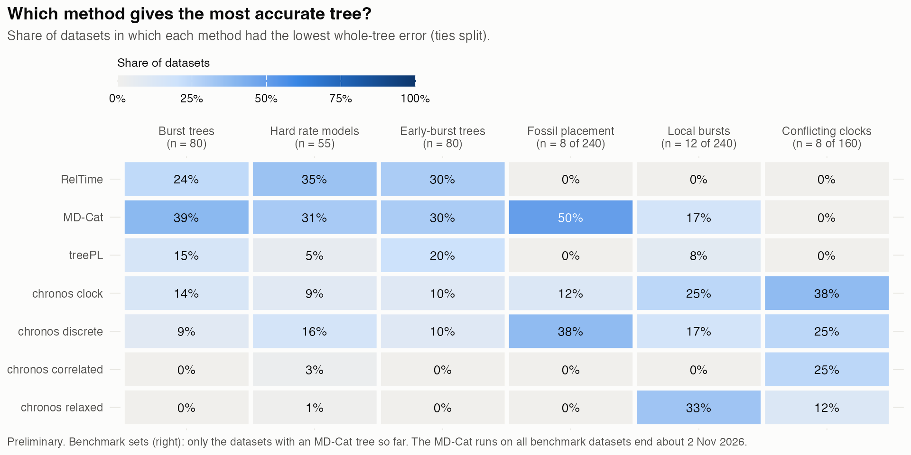
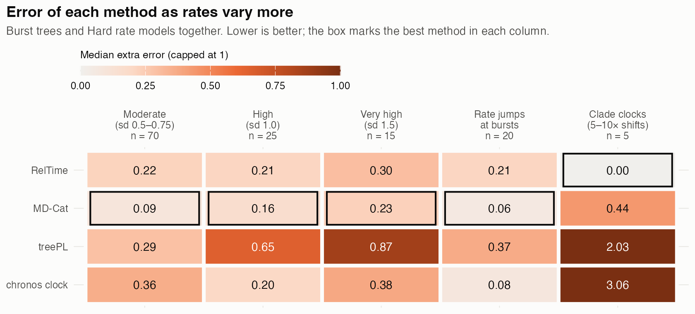
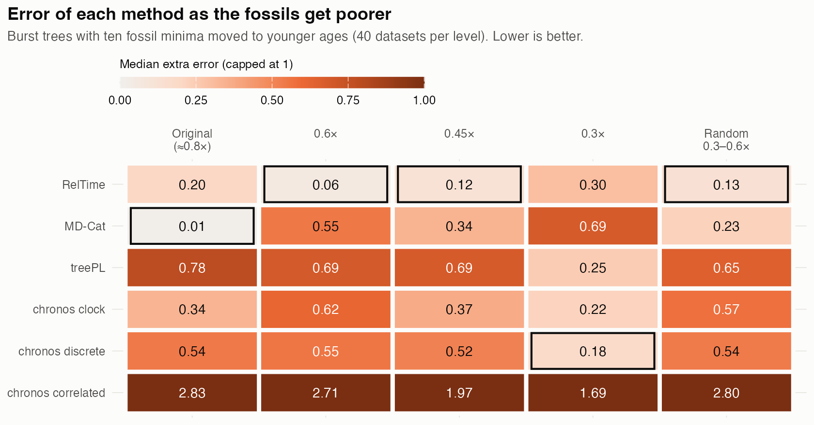
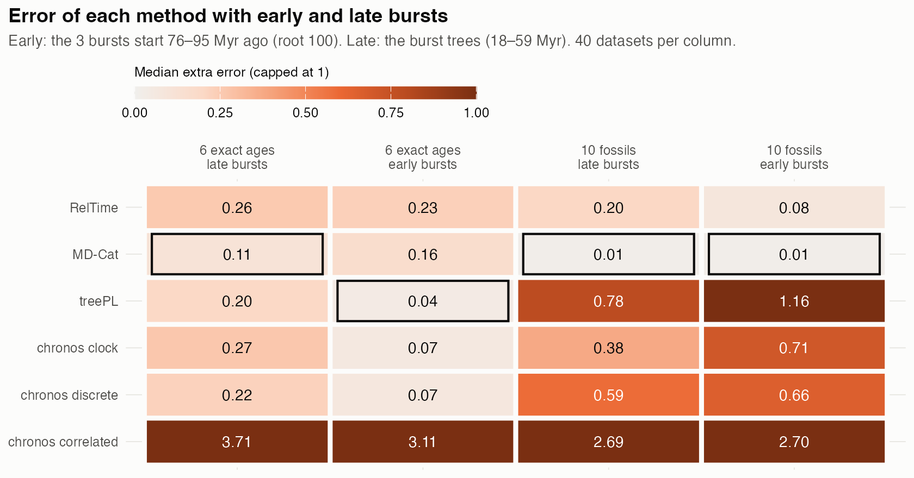

# Phylogenetic dating methods under heterogeneous rates and calibrations

([GitHub repository](https://github.com/betanri/PhyloDatingMethodsSimsComps))

RelTime, treePL, four `chronos` models, and MD-Cat were compared on simulated trees where the true node ages are known. The question is straightforward: **which methods recover the right ages, and under what combinations of heterotachy, calibration quality, and tree shape?**

The main result is also straightforward: **there is no single best dating method.** Performance depends strongly on the process generating among-lineage rate variation and on how informative the calibrations are.

**Status (1 Nov 2026): preliminary.** MD-Cat is still running on part of the benchmark sets. It currently has trees for 28 of the 640 benchmark datasets; all 640 are expected around 2 Nov. The poor-fossil benchmark refits and remaining side sets follow after that. The burst, hard-rate, and early-burst simulations are complete, so those results should not change (except 2–3 MD-Cat trees still missing at two poor-fossil levels of the burst trees).

Changes since 31 Oct:

- Every dated tree is now scored, including cases where two methods return the same tree. Previously, duplicate trees were collapsed, which removed many `chronos relaxed` results because it often matches `chronos correlated`.
- Some `chronos discrete` fits failed because of an `ape` numerical bug on phylograms with very long branches. Those were rerun with a fixed copy of the function. The fix does not change successful fits. It changed the selected tree in 4 datasets and produced a `chronos discrete` tree for 7 benchmark datasets that previously had none.
- Missing `chronos clock` and treePL trees were filled.
- Six `chronos clock` trees had one slightly negative branch. In those cases the affected node was set to the age of its parent; the adjustment was ≤0.39 Myr.

---

## Main result

The two things that matter most are:

1. **the form of heterotachy across the tree**, not simply how large the variance in rates is; and
2. **the information in the calibrations**, including whether they are exact ages, informative fossil minima, poor minima, or very wide brackets.

The values in parentheses below are the median **extra error** relative to the best method in the same dataset:

`extra error = (error of method / error of best method) - 1`

So 0 means the method gave the most accurate dated tree, and 1 means its error was twice that of the best method.

Most conditions have only 5–20 datasets, so differences smaller than about 0.1 are probably ties.

### Moderate heterotachy

With moderate among-lineage rate variation (log-SD 0.5–0.75), most methods are fairly close, but the winner still depends on how the rates change across the tree.

- **Autocorrelated / inherited rates:** RelTime is best (0.05), followed by treePL (0.13). MD-Cat is worse (0.62).
- **Discrete rate classes:** MD-Cat is clearly best (0.00); every other method is ≥0.6.
- **Uncorrelated / independent rates:** `chronos clock`, MD-Cat, and `chronos discrete` are effectively tied (0.10–0.11). treePL is close (0.14), and RelTime is slightly worse (0.20).

The discrete-rate result is important but not surprising: MD-Cat explicitly models branches as belonging to rate categories, so this is the simulation where the generating process most closely matches the inference model.

### Extreme heterotachy

The methods separate much more strongly when the rate variation becomes extreme (log-SD 1.0–1.5).

treePL does badly under strong heterotachy. Its extra error reaches 0.9–3.7 under strong autocorrelated and strong discrete-rate models.

Again, the best method depends on the form of heterotachy.

- **Strong autocorrelation:** RelTime is best at both levels (0.00). At the strongest level, `chronos correlated` and `chronos relaxed` are second (0.23).
- **Strong discrete rate classes:** MD-Cat is best (0.00), while RelTime is much worse (0.8–0.9).
- **Very strong uncorrelated rates (log-SD 1.5):** RelTime (0.03) and `chronos discrete` (0.04) are best, ahead of treePL (0.29) and MD-Cat (0.31).
- **Local clocks / clade-wide shifts:** when entire clades shift to rates 5–10× faster or slower than the background, RelTime is best (0.00), MD-Cat is second (0.44), and the other methods are much worse (roughly 2–3).

Pooling all of these by “heterotachy level” makes MD-Cat look best at most levels because it dominates the discrete-rate simulations. Model by model, the picture is different. Under extreme heterotachy, RelTime is the safer general method unless there is good reason to expect a small number of discrete rate classes.

Each hard-rate model has only five replicates, so these should be treated as strong trends, not precise rankings.

### Phylograms estimated from DNA

Alignments were also simulated, and the phylogram was re-estimated from them with IQ-TREE instead of giving the dating method the exact simulated substitutions-per-site tree.

Under those conditions, the methods converge again. `chronos clock` and `chronos discrete` are best or near-best across the four sequence-based models (0.00–0.16). treePL becomes substantially worse as heterotachy increases (0.42–1.25).

This adds phylogram-estimation error to the dating problem. The method is no longer seeing the exact branch lengths generated by the simulated clock process.

---

## Rapid radiations and local rate shifts

Two problems were simulated that are often grouped together as “bursts” but are phylogenetically different.

### Speciation bursts

In the burst-tree simulations, three clades undergo short intervals of elevated speciation, producing many short internodes. Some simulations also impose a rate increase on the branches inside those radiations.

With a speciation burst plus a rate jump, MD-Cat (0.06), `chronos clock` (0.08), and `chronos discrete` (0.10) are best for both the whole tree and the nodes inside the burst clades. RelTime (0.21) and treePL (0.37) are worse.

### Rate bursts and conflicting clocks

The local-burst simulations instead impose one or two clades that evolve 3–4× faster than the rest of the tree (in one pattern a deep clade also slows to 0.35×). The conflicting-clock simulations make a nested clade follow a different clock process from the backbone.

For whole-tree accuracy, `chronos clock` is best or near best across all local-burst patterns (0.06–0.12) and best under both moderate and strong clock conflict (0.07). With a slow deep phase followed by a shallow burst, `chronos relaxed` is a little better (0.06 against 0.10). RelTime and treePL are much worse (0.8–3.8).

But the whole-tree score hides what happens inside the affected clade.

- With two medium-depth rate bursts, `chronos relaxed` is best inside the burst clades (0.00), while `chronos clock` is poor (1.51).
- With a slow deep phase followed by a shallow fast burst, treePL is best inside the burst (0.00).

So a method can give the best average node ages across the tree while doing badly exactly where the clock changes.

MD-Cat currently has trees for only 12 local-burst and 8 conflicting-clock datasets. In those preliminary runs it is far from the best (median extra error 1.04 and 3.51), but this comparison is still incomplete.

---

## Early radiations

The early-burst simulations use the same design as the regular burst trees, except that the three rapid radiations start near the root, 76–95 Ma on a 100-Ma tree rather than 18–59 Ma.

This is a harder dating problem for every method.

Across all 80 early-burst datasets, MD-Cat is best overall (0.08), followed by RelTime (0.15). But calibration type changes the ranking.

### Exact ages

With six exact calibrations:

- treePL: 0.04
- `chronos clock`: 0.07
- `chronos discrete`: 0.07
- MD-Cat: 0.16
- RelTime: 0.23

With nearly ideal calibration information, treePL and the `chronos` clock and discrete models perform very well even when the radiation is deep (`chronos correlated` and `chronos relaxed` do not: 3.11).

### Fossil calibrations

With 10 fossil calibrations:

- MD-Cat: 0.01
- RelTime: 0.08
- other methods: 0.66–2.70

The difference is large. Once the calibrations are asymmetric fossil minima rather than exact ages, MD-Cat and RelTime are much more robust.

All methods are less accurate for early than later radiations. Median whole-tree error is 1.25–1.58× larger depending on the method.

With fossils, every method places the root too old, and more so in the early-burst trees. Median root error there is +7% for MD-Cat, +14% for RelTime, and +23–25% for the other methods, against +1%, +9%, and +12–16% with later bursts.

---

## Calibration quality matters as much as clock model

The calibration simulations may be the most relevant part for empirical dating.

### Exact calibrations

On the burst trees with six exact node ages, all methods are reasonably close:

- MD-Cat: 0.11
- treePL: 0.20
- `chronos discrete`: 0.22
- `chronos clock`: 0.25
- RelTime: 0.28

This is the easy case. The calibrations constrain the solution strongly, leaving less room for clock-model misspecification to move ages.

### Informative fossil minima

With 10 fossils whose minima fall at 0.60–0.98× the true node age:

- MD-Cat is best by a wide margin (0.02)
- RelTime is second (0.20)
- treePL is much worse (0.78)

### Poor fossil minima

Real fossils are often much younger than the nodes they constrain. The fossil minima were therefore moved progressively farther below the true ages: 0.6×, 0.45×, 0.3×, and random values between 0.3× and 0.6×.

Under these poorer minima, RelTime becomes the best method in most conditions.

- 0.6×: RelTime 0.11
- 0.45×: RelTime 0.15
- random 0.3–0.6×: RelTime 0.17
- 0.3×: `chronos discrete` 0.18, `chronos clock` 0.25, treePL 0.35, RelTime 0.38

MD-Cat loses the most as fossil minima become less informative, moving from 0.01 with the original fossils to 0.29–0.71 under poor minima.

---

## The benchmark sets behave differently

The benchmark simulations use very wide calibration brackets rather than the tighter fossil scheme above. The root bracket spans 0.8–3× the true root age, and 31% of the minimum bounds are older than the true node age.

That is not a realistic fossil configuration, but it is useful for testing how methods behave when calibrations are weak and partly incompatible with the truth.

Under those wide brackets, `chronos clock` is best across shallow, deep, and mixed calibration placement (0.07–0.14), across extinction rates (0.06–0.12), and across calibration densities. (MD-Cat is left out of this comparison until its runs end.)

With only three brackets, RelTime and treePL become much worse (2.4–9.9).

The caveat is important: almost every dated tree in these benchmark sets is too old. Much of the ranking therefore reduces to **which method places the root youngest inside a very broad allowed interval**.

That is not the same problem as recovering node ages under realistic fossil minima.

### Poor-fossil benchmark refits

All 640 benchmark datasets were also rerun under modified minimum bounds:

1. original minima,
2. only impossible, too-old minima moved down to the true age,
3. random minima at 0.3–0.6× the true age.

Smaller subsets were also rerun at fixed 0.6×, 0.45×, and 0.3× minima.

In these refits, RelTime is best at every level (median extra error 0.00–0.09) and is the most accurate method in 41–54% of datasets with the original minima, 65–75% after correcting impossible minima, and 62–94% under poor minima.

But even the best dated tree still places the root at 1.6–2.3× the true root age. So in many of these refits, the youngest solution wins simply because all methods are too old.

MD-Cat is in only 28 of the refits at the original minima so far, and not yet in the others.

---

## `chronos correlated` and `chronos relaxed`

On the simulated sets, `chronos correlated` and `chronos relaxed` return the same dated tree in almost every dataset and are usually far from the best (extra error around 1–4 in many conditions).

On the benchmark sets, `chronos relaxed` improves substantially (0.5–1.1). It is the best method inside burst nodes in the two-medium-burst condition, and for the whole tree with a slow deep phase followed by a shallow burst.

A practical issue is that many `chronos correlated` and `chronos relaxed` fits stop at or near their starting dates, which are often the treePL solution. In those cases the phylogram contributes little new information to the final ages.

---

## Short version

- **No method wins everywhere.**
- **The structure of heterotachy matters.** Autocorrelated rates, uncorrelated rates, discrete classes, local clocks, and punctuated shifts are not interchangeable forms of “rate variation.”
- **RelTime is strongest under autocorrelated rates, local clocks, very strong uncorrelated heterotachy, and poor fossil minima.**
- **MD-Cat is strongest when rates fall into discrete classes and when fossil minima are informative.**
- **`chronos clock` and `chronos discrete` do well with estimated phylograms, local rate bursts, and the wide-bracket benchmark sets.**
- **treePL is not a good default under strong heterotachy or fossil-minimum calibrations.**
- **Deep rapid radiations make every method less accurate.**
- **The best whole-tree method can still be poor inside the clade where the rate shift actually occurred.**
- With empirical data, where the true rate process is unknown, the safest strategy is probably to date with at least **RelTime and MD-Cat** and inspect where their ages disagree.

---

## What was simulated

Each dataset follows the same workflow:

1. Simulate a true time tree under a birth–death process.
2. Simulate branch-specific substitution rates under a specified clock/heterotachy model.
3. Multiply rate × time to obtain the phylogram in substitutions per site.
4. Generate calibrations from the known true ages.
5. Date the same phylogram with each method.
6. Compare inferred node ages with the truth.

### Simulation sets

| Set | Datasets | Tree design | Rate process | Calibrations |
|---|---:|---|---|---|
| **Burst trees** | 80 | 10 trees, 93–118 tips, root age 100; three rapid radiations starting 18–59 Ma | autocorrelated, uncorrelated, discrete classes, punctuated rate jumps | 6 exact ages or 10 fossils |
| **Hard rate models** | 55 | Trees 1–5 from the burst set | 11 stronger heterotachy models | 6 exact ages |
| **Early-burst trees** | 80 | 10 trees, 93–120 tips, root age 100; bursts starting 76–95 Ma | same four models as burst trees | same two calibration schemes |
| **Fossil placement** | 240 | 150 tips sampled from a 1,500-tip tree | strict, uncorrelated, autocorrelated, discrete; two heterotachy levels; extinction 0 or 0.8 | wide brackets placed shallow, deep, or mixed |
| **Local bursts** | 240 | 150 tips | background clock plus one or two clade-specific rate shifts | 3 or 8 wide brackets |
| **Conflicting clocks** | 160 | 150 tips | backbone clock plus nested clade evolving under a different clock process | 3 or 8 wide brackets |
| **Side sets** | 92 + 23 | 150 tips | earlier benchmark conditions and MD-Cat side checks | variable |

**Total: 970 datasets.**

The fossil-placement, local-burst, and conflicting-clock datasets come from an earlier benchmark suite and are referred to here as the benchmark sets.

### Rate models

| Label | Interpretation |
|---|---|
| strict | One substitution rate across the tree |
| inherited | Autocorrelated lognormal rates; daughter branches inherit rates close to the parent |
| independent | Uncorrelated lognormal rates |
| rate classes | Branches assigned to a small number of discrete rate categories |
| rate jumps at bursts | Punctuated rate increase within radiation branches |
| high / very high variation | Uncorrelated rates with log-SD 1.0 or 1.5 |
| strong inherited | Strong autocorrelated heterotachy |
| strong rate classes | Strong discrete-class heterotachy |
| clade clocks | Local clocks with entire clades shifted 5–10× faster or slower |
| simulated DNA | AliSim sequence simulation followed by phylogram re-estimation in IQ-TREE |

The 11 hard-rate models are two high/very-high uncorrelated models, two strong autocorrelated models, two strong discrete-rate models, one local-clock model, and four sequence-based models.

### Calibration models

- **Exact ages:** node ages fixed to the true value.
- **Fossil minima:** minimum constraints at 0.60–0.98× the true age, with maxima near 1.2×.
- **Poor fossil minima:** the same fossils moved to 0.6×, 0.45×, 0.3×, or random 0.3–0.6× of the true age.
- **Wide brackets:** benchmark intervals, with root bounds spanning 0.8–3× the true age.

The benchmark brackets are intentionally loose. Their minima average roughly 0.82× the true node age, but 31% are older than the truth.

---

## Dating methods

| Method | Model |
|---|---|
| **RelTime** | Relative lineage rates without assuming a single global clock |
| **treePL** | Penalized likelihood with smoothing chosen by cross-validation |
| **chronos clock** | Penalized likelihood under a strict-clock formulation |
| **chronos correlated** | Penalized likelihood with autocorrelated rates |
| **chronos relaxed** | Penalized likelihood with uncorrelated (independent) rates |
| **chronos discrete** | Penalized likelihood with a few discrete rate categories |
| **MD-Cat** | Maximum likelihood with discrete rate categories |

All methods were run through the PhyloChronoRank dating pipeline, frozen at commit [`a8ba7e0`](https://github.com/betanri/PhyloChronoRank/tree/a8ba7e0a3791c0667175093ed2f4f654c41f3d98), using the settings from its worked examples.

---

## Accuracy metrics

### Whole-tree error

Mean absolute node-age error across all internal nodes, divided by the true root age.

### Burst error

The same metric, restricted to nodes inside the simulated burst clades.

### Extra error

For each dataset:

`extra error = (error of method / minimum error among methods) - 1`

A value of:

- **0** = best method in that dataset
- **0.5** = 50% more error than the best method
- **1** = twice the error of the best method

### Most-accurate share

Fraction of datasets in which the method gives the lowest error. If two methods return the same dated tree, the share is split.

Each method is compared only against the other methods run on the same dataset.

---

## Results

### 1. Which method gives the most accurate tree?

- **Burst trees:** MD-Cat is best most often (39%), followed by RelTime (24%). MD-Cat also has the lowest median extra error (0.10).
- **Hard-rate models:** RelTime (35%) and MD-Cat (31%) are essentially tied for wins. RelTime has slightly lower median extra error (0.13 vs. 0.16).
- **Early-burst trees:** MD-Cat and RelTime each win 30% of datasets. MD-Cat has the lower median extra error (0.08).
- **Benchmark sets without MD-Cat:** `chronos clock` wins 40–45%, `chronos discrete` 28–36%, and `chronos relaxed` 9–23%. RelTime is rarely best (0–4%). Because nearly all dated trees are too old, this mostly reflects root placement within broad calibration brackets.
- **Benchmark datasets with MD-Cat currently available (n = 28):** `chronos clock` (0.13) and `chronos discrete` (0.22) remain best overall. MD-Cat is the most accurate tree in 6/28 datasets, including 4/8 fossil-placement datasets, but its median extra error is 1.37. This is still a biased subset of benchmark conditions.

### 2. Effect of heterotachy

Pooling by heterotachy level makes MD-Cat look best at most levels, but that summary hides the generating model.

- MD-Cat dominates discrete-rate simulations.
- RelTime is best with strong autocorrelation and local clocks, and ties with `chronos discrete` with very strong uncorrelated rates.
- treePL deteriorates steadily as heterotachy increases: 0.31 → 0.65 → 0.87.
- `chronos correlated` and `chronos relaxed` give the same tree in these simulations, so their rows are the same.
- The local-clock condition has only five replicates.

So the biologically relevant distinction is not simply “low vs. high rate variation.” It is **what kind of process generated the heterotachy**.

### 3. Poor fossils

With informative fossil minima, MD-Cat is best. As fossil minima are pushed farther below the true ages, RelTime becomes more robust.

- Original fossils: MD-Cat 0.01
- 0.6× minima: RelTime 0.11
- 0.45× minima: RelTime 0.15
- random 0.3–0.6× minima: RelTime 0.17
- 0.3× minima: `chronos discrete` 0.18, `chronos clock` 0.25, treePL 0.35, RelTime 0.38

MD-Cat changes the most across this gradient (0.01 → 0.29–0.71). It has a tree in 37 of the 40 datasets at the original level and 38 at the random level so far.

The best tree keeps the root near the truth under all these conditions: 1.01× the true root with the original fossils and 0.92–0.94× under poor minima.

### 4. Early radiations

Early rapid radiations are harder for all methods.

Compared with later-burst simulations, median whole-tree error increases by:

- RelTime: 1.42×
- MD-Cat: 1.58×
- treePL: 1.49×
- `chronos clock`: 1.45×
- `chronos discrete`: 1.34×

With fossils, MD-Cat (0.01) and RelTime (0.08) remain clearly best.

With exact ages, treePL (0.04), `chronos clock` (0.07), and `chronos discrete` (0.07) are best.

The burst clades contain most of the nodes in the early-burst trees, so burst-only and whole-tree scores are nearly identical.

---

## Practical take

If the true branch-rate process were known, method choice would be easy.

- **Autocorrelated rates:** RelTime.
- **Local clocks / major clade-wide shifts:** RelTime.
- **Strong uncorrelated heterotachy:** RelTime or `chronos discrete`.
- **Discrete rate classes:** MD-Cat.
- **Rate jumps associated with radiations:** MD-Cat, `chronos clock`, or `chronos discrete`.
- **Good fossil minima:** MD-Cat.
- **Poor fossil minima:** RelTime.
- **Very wide calibration brackets:** `chronos clock` performs well, but much of that result reflects root placement rather than accurate recovery of all node ages.
- **Strong heterotachy:** do not use treePL as the only analysis.

With empirical data the true rate process is usually unknown. That is the whole problem.

So the practical recommendation is not to call one method universally “best.” Use methods with different assumptions, especially **RelTime and MD-Cat**, and pay attention to the nodes where their ages disagree. Those disagreements are probably informative about model sensitivity, heterotachy, and calibration leverage.

---

## Limits

- These are simulations. Their relevance depends on whether the simulated forms of rate heterogeneity resemble real phylograms.
- Each hard-rate model has only five replicates.
- The benchmark calibration scheme is unusual: brackets are very broad and 31% of minimum bounds are older than the true ages.
- MD-Cat is still incomplete for the benchmark sets.
- In the benchmark refits, the `chronos` fits often stay near their treePL starting dates, so RelTime looks stronger there than in the benchmark's own fits.
- Whole-tree error can hide poor performance inside the clade where the rate shift occurred.
- Sequence-based simulations include phylogram-estimation error, but they still do not reproduce all sources of empirical model misspecification, compositional heterogeneity, alignment error, or locus-to-locus discordance.

---

## Files

| Path | Contents |
|---|---|
| `figures/` | Figures used in this report |
| `scripts/report_tables.R` | Builds the summary tables in `results/summary/` |
| `scripts/make_report_figures.R` | Draws figures from the summary tables |
| `scripts/method_by_condition.R` | Median extra error by method and condition |
| `scripts/sim_make_datasets.R` | Generates burst, hard-rate, and early-burst datasets |
| `scripts/sim_date_truth.py` | Runs the dating pipeline and scoring |
| `scripts/sim_date_error.R` | Whole-tree, burst, and root-age error |
| `scripts/sim_accuracy_table.R` | Scores dated trees against the true trees |
| `scripts/sim_early_burst_report.R` | Summarizes burst-clade sizes |
| `results/accuracy/` | Per-tree errors and method counts |
| `results/summary/` | Median extra error and win shares by condition |
| `results/poor_fossils/min_factors.csv` | Fossil-minimum scaling used in the poor-fossil analyses |

The simulated and dated trees (~2 GB) are not stored in this repository. Some scripts retain absolute paths from the machine where the analyses were run.

### Code names

| Report label | Code/table label |
|---|---|
| Burst trees | sim main |
| Hard rate models | sim het |
| Early-burst trees | sim early burst (early in `results/summary/early_bursts.csv`) |
| Fossil placement | Codex F / benchmark F |
| Local bursts | Codex G / benchmark G |
| Conflicting clocks | Codex H / benchmark H |
| Side sets | Codex C, D, E + MD-Cat checks |
| 6 exact ages / 10 fossils | sparse6 / fossil10 |
| 3 / 8 wide brackets | sparse3 / dense8 |
| inherited / independent / rate classes / punctuated | acln / ucln / discrete / punct |
| clade clocks | localclock |
| sequence-based phylograms | seqhomo / seqhet |
| original / 0.6× / random 0.3–0.6× fossils | sim main refit / sim main min 0.60 / sim main min 0.3-0.6 |
